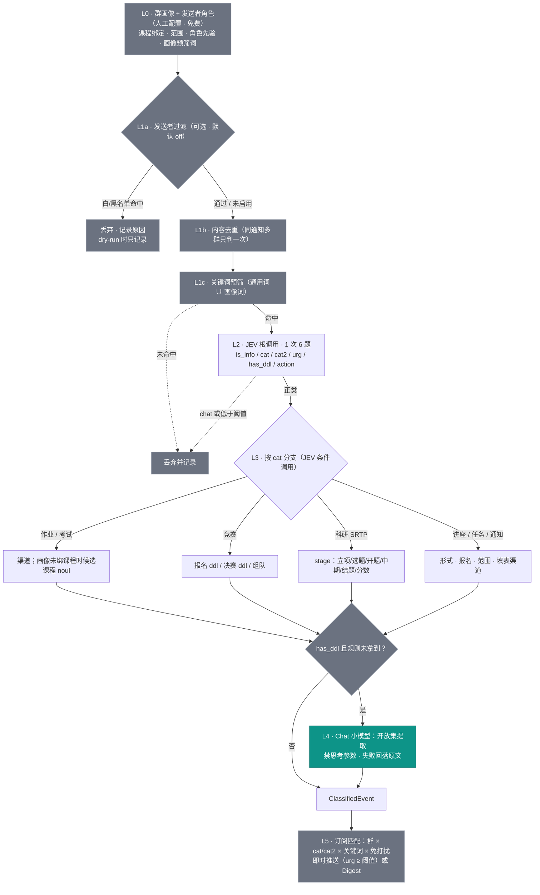

# 架构总览

> 版本 v0.1 · 2026-10-25 · 本文是架构的唯一权威描述

## 设计原则（一句话）

> **封闭集的判断交给 JEV，开放集的抽取交给小模型，字面匹配交给规则，元数据（群/发送者）交给画像——模型调用量沿「免费 → 便宜 → 贵」单向递增。**

## 分层管线



图例：**蓝 = JEV 判断（按消息计费）· 灰 = 规则与人工配置（免费）· 青 = Chat 小模型（仅按需触发）**。多数消息死在 L0/L1，到达 L4 的是正类里的个位数百分比。

## 各层职责

| 层 | 工具 | 输入 → 输出 | 成本 |
|---|---|---|---|
| L0 渠道画像 | 人工配置（groups.yml） | 群 + 发送者 → 课程绑定 / 范围 / 角色先验 / 画像预筛词 | 免费 |
| L1a 发送者过滤 | 规则（可选，默认 off） | 白/黑名单 → 丢弃或放行 | 免费（有损） |
| L1b 内容去重 | 规则（内容 hash） | 同内容多群转发 → 一次分类、多群 fan-in | 免费 |
| L1c 关键词预筛 | 规则（通用词 ∪ 画像词） | 命中才进模型 | 免费 |
| L2 JEV 根调用 | NeoHorse-Jev-4B `/v1/decision` | 留/不留 + cat1 + cat2 + urg + has_ddl + action | 按消息 |
| L3 分支 | JEV 条件调用 | 按 cat 问封闭集字段（stage/channel/format/scope…） | 按正类 |
| L4 信息提取 | neohorse-1-9b（Chat Completion） | 开放集字段：deadline / exam_time / time+place | 按需（极少） |
| L5 匹配分发 | 规则（SQLite） | 群 × cat/cat2 × 关键词 × 免打扰 → 即时推 / Digest | 免费 |

各层细节见 [classification.md](classification.md)，配置 schema 见 [config.md](config.md)。

## 数据契约

```jsonc
// RawEvent —— 所有采集源（QQ群/爬虫/用户上报）归一后的唯一入口结构
{
  "source": "qq_group",              // qq_group | web_crawl | user_report
  "group_id": "123456789",
  "group_name": "马原群",
  "sender_id": "10001",
  "sender_card": "王老师",
  "msg_id": "...",
  "text": "...",
  "ts": 1761360000,
  "at_all": true
}

// ClassifiedEvent —— 分类树的唯一输出（分类器契约，与模型实现解耦）
{
  "event_id": "...",
  "groups": ["123456789", "987654321"],   // 去重后所有来源群；匹配任一命中即推
  "cat": "homework",                       // 9 类之一
  "cat2": "notice",                        // 次类别，可与 cat 相同 = 无
  "is_info": 0.93,                         // JEV noul 原始值
  "urg": 2,                                // 0-3
  "action": "submit",                      // submit | signup | attend | know
  "has_ddl": true,
  "course": "马原",                         // 画像绑定或提取
  "scope": "course",                       // course | grade | class | school
  "channel": "chaoxing",                   // chaoxing | yuketang | email | offline | other
  "stage": null,                           // research 类：立项/选题/开题/中期/结题/分数
  "deadline": "2026-11-15T23:59:00+08:00", // 规则或 L4 产出
  "deadline_src": "regex",                 // regex | llm | none
  "low_conf": false,                       // choice 概率边缘 / 兜底触发 / L4 失败
  "raw_text": "...",
  "model_calls": ["jev:root", "jev:branch:homework"]
}
```

**契约先于实现**：分类器模块只认 `RawEvent → ClassifiedEvent`。今天接 neohorse-1-9b 做提取、明天换模型/换 JEV，上层无感——与 OneBot「只对接协议」同一思路。

## 关键不变量

1. **分类一次，匹配多次**：每条消息只过树一次；匹配 N 个用户是本地查询。模型成本只与消息量有关，与用户数无关（规模化的前提）。
2. **预筛链顺序不可反**：发送者过滤 → 去重 → 关键词。若先去重，被发送者过滤丢掉的拷贝已登记 hash，同内容在其他群的拷贝会被误判“已见过”而跳过——过滤丢弃污染去重状态，造成静默漏报。
3. **去重 fan-in**：一条 ClassifiedEvent 记录所有来源群；省的是分类成本，不是分发覆盖面。
4. **宁漏勿误**：负类静默是生死线（误推十条九条垃圾 → 用户静音/删好友，试点即死）。所有阈值默认从严。
5. **有损过滤器四原则**：默认关闭 · 可 dry-run · 可审计 · 一键恢复。发送者过滤是唯一有损预筛，按此实现。
6. **画像绑定用 group_id 不用群名**：改名/换届不失效；群名只是标签。

## 模型接入

### JEV（NeoHorse-Jev-4B，主分类器）

| 项 | 值 |
|---|---|
| 端点 | `POST https://tokenrhythm.studio/v1/decision`（System One 兼容：`/v1/systemone`） |
| 鉴权 | `Authorization: Bearer <平台Key>`，`Content-Type: application/json` |
| 题型 | `noul`（0~1 成立概率）/ `choice`（选项 + probabilities）/ `score`（0 编号等级期望） |
| 限额 | 每次 1~16 题；纯文本 JSON ≤ 1 MiB；带图（1 张 PNG base64）≤ 8 MiB 且只能一题 |
| 计费口径 | `/v1/decision` 优先记打包输入 `input_tokens`，未提供用 `input_details.expanded_tokens`；**题数在 1~16 间几乎不增加成本**（同一份 state） |
| 错误 | 401 密钥无效 / 403 无灰度 / 413 超限 / 422 参数或上游输入限制 / 429 容量限流 / 502-504 上游故障；统一返回 `code`/`message`/`traceId` |
| 硬约束 | 上游有输入 token 上限且**不会静默截断**（长合并转发会 422）→ state 自行截断到 ~1500 字并加截断标记；**已发送的超时请求不要无条件重试**（用内容 hash 做幂等键）；概率与 confidence 不可当作经校准的正确率 |

调用纪律：有界并发队列 + 指数退避（429）；traceId 留档；相同 state 文本命中缓存直接复用。

### neohorse-1-9b（仅 L4 开放集提取）

| 项 | 值 |
|---|---|
| 协议 | Chat Completion（OpenAI 兼容），tokenrhythm.studio 平台 |
| **硬约束** | **请求禁止携带任何思考参数**——该模型只接受"不思考"，带任何推理档位字段一律 400（模型/网关自身限制，与客户端无关）。封装前先用最小请求（空 system + 一条 user message、无 reasoning 字段）验证 200 |
| 用途 | 仅开放集提取：deadline / exam_time / time+place 归一化。不判类别、不提课程 |
| 回落链 | 解析失败 → 带错误信息重试 1 次 → 规则结果 → "见原文" + `low_conf` 进人工复核队列 |
| 成本 | 免费额度有期限：从第一天记录每次调用 token 用量，到期前计算迁移成本（契约不变，换模型只是配置改动） |

### JEV 的备用位置（选项，不急着上）

小模型判了正类但 `is_info` 边缘时，可用 `/v1/decision` 单问一题 noul 做二级复核——便宜的二审。

## 部署

| 阶段 | 环境 | 说明 |
|---|---|---|
| 开发/打通 | Windows 11 | NapCat + 业务进程 + SQLite 全在一台机 |
| 常驻 | 香橙派 4 Pro（RK3588S / ARM64 / 6GB / Debian，家庭局域网） | 只是"搬家"：业务代码全平台通用，改 `.env` 里的 OneBot WS 地址与 token，零代码改动 |

迁移前必须埋好的点：

- 所有路径/端口/token 走 `.env` 或配置文件，代码零硬编码（同时满足"工作文件不放 系统盘"的约束）
- SQLite 单文件 + WAL，备份 = 拷贝文件
- NapCat 上 Pi：确认 arm64 部署方式（Docker 多架构镜像或 Python 直跑）；无头环境无扫码框，登录入口用日志链接或 WebUI，**提前试通**
- 掉线看门狗：QQ 登录态会过期，检测掉线 → 告警管理员（Pi 无人值守时是刚需）
- 业务机连 Pi 上的 NapCat 走局域网固定 IP / 主机名

## 风险与缓解

| 风险 | 缓解 |
|---|---|
| **封号**（非官方客户端固有） | 用注册过一段时间的**小号**，不用主号、不用刚注册的号；发送限速；避开 go-cqhttp/Mirai 等停更/被针对的实现 |
| **隐私**（群消息是他人内容） | 最小化保留（hash + 原文，N 天自动清理）；bot 进群明示存在；不把 A 群消息原文透给无关用户 |
| **平台 ToS** | 学习通/雨课堂 cookie 爬虫违反服务条款，只做个人尺度；先走"用户转发上报"零风险路径 |
| **模型配额/限流** | 五层防线（见 classification.md）；预筛 + 缓存 + 可选发送者过滤压量；超预算报警 |
| **画像配置错误**（绑错课程 = 路由错） | 画像变更写审计日志；dry-run 先评估；错误只影响路由不污染分类树 |
| **掉线**（登录态过期） | 看门狗告警；重扫流程文档化 |
