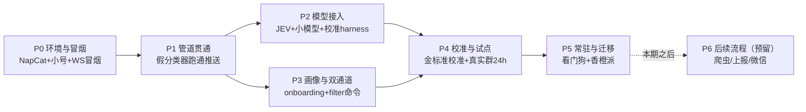

# 搭建规划（build plan）

> 版本 v0.2 · 2026-10-25 · 依据 ADR-019（先规划后动手、垂直切片）编写。每阶段出口 = 对应验收条目变绿 + 如有决策则追加 ADR。

## 总原则

1. **垂直切片**：每个阶段独立可验，验收条目逐阶段挂钩（见 acceptance.md）；管道先于模型，模型先于校准，校准先于试点，试点先于迁移
2. **配置驱动从第一天开始**：groups.yml / tree.yml 是唯一配置源；命令与 YAML 双通道写同一份数据（ADR-018）
3. **一切文件在 项目内**：venv、pip 缓存、NapCat、数据、日志全部在项目根目录内，不写系统目录
4. **测试期零真实推送**：分发走文件模式（outbox/<用户QQ>/*.txt，ADR-021），真实 QQ 推送试点审批后再开
5. **可回滚**：每阶段的功能都有开关（sender_filter 默认 off、L4 可关、即时推可降级 digest-only），出问题先关开关再排查
6. **预估轮次** = 与 AI 协作的会话轮次，非工时

## 阶段总览

P2 与 P3 无相互依赖，可并行。关键路径：P0→P1→P2→P4→P5。

---

## P0 环境与冒烟（预计 1 轮）

**目标**：小号能登录、OneBot 事件能实时到达我们的代码、项目骨架立起来。

**步骤**：

1. 建项目骨架：目录结构（src/ 布局，见 config.md 代码骨架）+ `.gitignore` + `.env.example` + `requirements.txt` + `pyproject.toml`
2. Python venv **建在 项目内**（`.venv/`）；`PIP_CACHE_DIR` 也指向项目内（避免 pip 缓存落到系统临时目录）
3. 安装 NapCat（Win11，解包到项目 `napcat/`）：配置 OneBot 11 反向 WS（`ws://127.0.0.1:3001` + token）→ 扫码登录小号
4. 冒烟模块 `python -m qq_relay.smoke`：起反向 WS 服务等 NapCat 连入，实时打印所有群消息事件，原始日志存 `data/logs/`
5. SQLite 建表：`events / items / users / subs / deliveries / labels / audit / model_calls / filtered_log`
6. 配置加载器：YAML → dataclass + 校验（未知 cat、缺字段直接报错，不带病启动）

**方案要点**：

- **扫码登录注意互挤**：小号扫码会把手机 QQ 顶掉线，用备用机扫码或接受互挤；**不要用刚注册的号**（风控敏感，见 ADR-001/011）
- 冒烟阶段不写任何业务代码，只验证"事件流"这一根基石——它不通，后面全白搭

**出口**：验收 A1（消息到达可观测、延迟可测）。冒烟日志存档备查。
**回滚**：无状态阶段，删目录即可。

---

## P1 管道贯通 · 假分类器（预计 2-3 轮）

**目标**：不依赖任何模型，把"群消息 → 分类 → 匹配 → 分发"整条管道跑通（测试期分发 = 写文件，ADR-021），并用规则假分类器产生逼真流量。

**步骤**（✅ = 已落地，2026-10-25）：

1. ✅ `src/qq_relay/adapters/onebot.py`：反向 WS **服务端**（NapCat 来连我们；重连由 NapCat 侧负责）、事件解析（群消息 + 私聊 + action 调用 + token 鉴权 + 自身回声过滤）
2. ✅ `src/qq_relay/adapters/base.py` + `contracts.py`：RawEvent 归一 + ClassifiedEvent 契约（P0 已建）
3. ✅ `src/qq_relay/pipeline/prefilter.py`：**发送者过滤（默认 off）→ 内容去重 → 关键词预筛（通用词 ∪ 画像词）**，顺序严格遵守（ADR-008）
4. ✅ `src/qq_relay/pipeline/classifier_stub.py`：关键词规则假分类器 → ClassifiedEvent（只用于打通管道与制造流量）
5. ✅ `src/qq_relay/pipeline/matcher.py`：订阅匹配（群 × cat/cat2 × 关键词 × 免打扰，OR 语义，跨午夜免打扰）
6. ✅ `src/qq_relay/deliver/base.py` + `file.py`：测试期分发——`data/outbox/<用户QQ>/` 下每条推送一个 txt（Digest 写 `digest-<date>.txt`，重名加序号防覆盖），文案与 QQ 推送同模板；`deliver/qq.py` 后置
7. ✅ `src/qq_relay/store/queries.py`：events / items / deliveries / filtered_log / labels / 去重映射 读写
8. ✅ `src/qq_relay/botcmd.py`：`/sub /unsub /sub list /mute /digest` + 负反馈（原子写 subscriptions.yml）
9. ✅ `src/qq_relay/main.py`：装配启动 + 看门狗 stub（NapCat 掉线告警）
10. ✅ `src/qq_relay/pipeline/runner.py`：管道编排 + **fan-in**（同通知多群只分类一次，新群命中用户才补收）

**方案要点**：

- **先假分类器是刻意的**：管道正确性（顺序 bug、去重 fan-in、防抖合并、匹配语义）不依赖模型质量，两边可分别调试；P2 只换分类器实现，契约不变（RawEvent → ClassifiedEvent）
- **顺序 bug 必须有单元测试**：已落地——`test_prefilter.py::TestOrderRegressionADR008` 与 `test_runner.py::test_adr008_sender_filter_no_dedup_poison` 双重钉死
- 测试期零真实推送：所有"推送"断言都落在 outbox 文件上（ADR-021）；真实推送的限速队列在 deliver/qq.py 里做

**出口状态**：58 项测试全绿（含 A3/A5 端到端断言：合成通知 → outbox 出文件；灌水 → 零文件；fan-in 不重发；重启后去重不丢）；**真实群验证待 NapCat 扫码登录后跑**（A1 通过即 P0/P1 合并出口达标）。
**踩坑记录**：YAML 1.1 把 `mode: off` 解析成布尔 `False`——加载器已加明确报错提示，配置里一律给 mode 加引号。
**回滚**：git 回退；关即时推送改 `instant_min_urg` 或 `DELIVER_MODE` 留文件但走 digest。

---

## P2 模型接入（预计 2-3 轮）

**目标**：真分类器替换假分类器；金标准校准工具链就绪。

**步骤**：

1. **连通性测试先行**（ADR-017）：chat 客户端最小请求（空 system + 一条 user、无 reasoning 字段）验证 200；JEV 最小 `/v1/decision`（一道 noul）验证。**不过就不往下走**
2. `src/qq_relay/pipeline/jev.py`：有界并发队列（默认并发 2-4）+ 指数退避（429）+ traceId 留档 + state 截断 1500 字 + 内容 hash 缓存 + 超时幂等（不无条件重试）
3. `src/qq_relay/pipeline/chat_client.py`（L4）：Chat Completion、JSON 输出契约、回落链（重试 1 次 → 正则 → 见原文 + low_conf）
4. `src/qq_relay/pipeline/tree.py`：按 tree.yml 驱动——根调用 6 题 → drop_if → 分支（**先实现 homework/exam**）→ 提取触发器（**正则先行**：dateparser/chrono）→ ClassifiedEvent
5. `config/groups.yml` + `config/tree.yml` 初稿落盘（题干、画像示例、阈值占位）——✅ 已落盘（P0/P1）
6. 金标准 harness：`goldset.jsonl` 加载 → 跑树 → 混淆矩阵 + 每类 P/R + low_conf 清单 + L4 触发率 + 调用/token 统计报表
7. 单元测试：分类器契约（字段完整）、降级链（模拟非法 JSON → 重试 → 兜底）、缓存命中、预筛顺序（P1 已带入）

**方案要点**：

- 题干、阈值、分支全部住 tree.yml——校准是改配置，不是改代码（P4 的校准循环因此可行）
- token 用量从第一通调用就开始落 `model_calls` 表（免费额度有期限，ADR-003）
- 准确率不达标的两套后备先写在代码结构里（开关式）：选项按画像收窄 + other 逃逸（G7）；根调用精简 3 题（G8）

**出口**：验收 B3（L4 触发率 <10%）、B4（回落 100%）、B7（用量落库）；B1 出初值（待 P4 校准）。
**回滚**：环境变量一键切回假分类器（`CLASSIFIER=stub|tree`）。

---

## P3 画像与双通道配置（预计 2 轮，可与 P2 并行）

**目标**：群画像体系可用；配置双通道落地；发送者过滤的安全导轨可用。

**步骤**：

1. groups.yml 加载 + role_prior 生效：state 注入画像上下文、默认 urg、画像预筛词并入通用词
2. 画像 onboarding 流程：新群首次见 → DM 管理员（群名 + 群主/管理员清单 + 按群名自动猜测）→ `/group bind`、`/role` 确认写入
3. `/filter status|dry-run|audit|mode` + `filtered_log` 落库 + `audit` 日志（谁/何时/改什么）
4. **配置管理器（双通道核心）**：所有 YAML 读写走单一模块——单写者原则（命令通道不直接写文件，交给配置管理器）、原子写（tmp + rename）、mtime 监听热更新（避免重启丢内存状态）
5. 管理员复核队列：low_conf 事件 DM 管理员 → 回复确认类别 → 写 `labels` 表

**方案要点**：

- 双通道的最大风险是**双写冲突**（命令写一半、人编辑一半）：单写者 + 原子写 + 写前重读，三件套在配置管理器里一次做对
- 热更新失败不影响运行中管道（旧配置继续生效 + 告警），不做"热更新失败就重启"的傻事

**出口**：验收 C1（在群 100% 有画像）、C4（dry-run 可跑）、C6（audit 可产出）。
**回滚**：配置管理器保留上一版本，`/config rollback` 还原。

---

## P4 校准与试点运行（预计 2-3 轮 + 你的标注时间）

**目标**：用真实数据把分类器调到验收线，并在真实群跑试点。

**步骤**：

1. **你提供金标准集**：30-50 条真实通知（含 SRTP ≥15 条），按 goldset 格式标注（cat/cat2/urg/deadline 标准值）
2. 校准循环：跑 harness → 改题干/阈值/别名词典 → 重跑，直到 B1/B5/B6 达标；**每次校准记日志**（改了什么、指标怎么动）
3. 课程别名词典初始化（按你的课程表）
4. 真实群 24h 试运行：统计命中率、误推数、按群准确率、跨画像冲突样本（C2）
5. 负反馈闭环："不感兴趣" → labels → 每周复盘调参
6. 2-3 个测试用户配订阅，C5 命中矩阵抽 20 组逐一验证

**方案要点**：

- 试运行期**发送者过滤只开 dry-run**，收集 M 值但不真滤（C4）；分发阈值从严，宁可进 Digest
- 误推是试点最大杀手（A5 生死线）：试运行前三天只开 Digest 不开即时分发，观察一天再放开（文件模式下"误推"= outbox 里多出垃圾文件）

**出口**：A2、A5、B1、B2、B5、B6、B8、C2、C3、C5 全绿。
**回滚**：任意指标恶化 → 关即时推送 / 回调阈值 / 回滚配置版本。

---

## P5 常驻与迁移香橙派（预计 1-2 轮）

**目标**：7×24 无人值守常驻，从 Win11 搬到家庭局域网香橙派。

**步骤**：

1. 看门狗完善：NapCat 存活探测（WS 心跳/事件超时）→ 掉线告警管理员（QQ 私信 + Server酱 双路）→ 自动重启 NapCat 进程
2. QR 重登录流程文档化（无头环境：日志内链接 / WebUI 扫码）
3. 可迁移打包：`requirements.txt`、`.env.example`、systemd unit（Pi）/ 任务计划程序（Win 备选）
4. 香橙派准备：Debian 更新、Python 3.11、固定内网 IP；**先验证 NapCat arm64 部署方式**（Docker 多架构镜像优先，不行 Python 直跑）——提前验证，别等迁移当天
5. 迁移执行：停 Win 实例 → 拷贝 `data/`（SQLite + 日志）与 `config/` → Pi 起服务 → 改 `.env` → 24h soak
6. 备份：SQLite 每日 `VACUUM INTO` 拷贝到 外部存储/NAS

**出口**：A6（看门狗告警）、A7（Pi 上 24h 无事故）。
**回滚**：Win 实例保持可启动状态一周，Pi 出问题切回。

---

## P7 对接产品计划文档（ADR-023，引擎侧，2026-10-26 落地）

| 项 | 状态 |
|---|---|
| 投稿提取栈（`pipeline/extract_stack.py` + `ocr.py` + `llm.py`） | ✅ OCR 专用协议（讯飞/通用 HTTP）→ 视觉模型（Chat Completion）→ 大模型（可选）→ 小模型（备用）四级降级；JEV 只管分类 |
| 用户投稿入口（`adapters/user_report.py` + `python -m qq_relay.submit`） | ✅ 本地 CLI + 程序化 intake；submissions 表全链路留档 |
| PushPlus 分发（`deliver/pushplus.py` + MultiDeliverer） | ✅ 每用户 token（users 表）+ 全局兜底；DELIVER_MODE 逗号组合 |
| 临期提醒调度（`pipeline/reminder.py`） | ✅ 截止前 24h/3h 多轮（REMINDER_OFFSETS 可配）；reminders 表 + runner reminder_hook |
| 核验数据层（votes 表 + `/confirm` `/report`） | ✅ 3 人确认标 verified；报错转人工 |
| 老库迁移（`store/db.py` _migrate） | ✅ items.verified/reminded_json、users.pushplus_token 幂等补齐 |

**待前端（计划书团队）**：公众号收发 → 调 intake；H5 看板 → 读 items/subs 数据导出；PushPlus 绑定 → 写 users.pushplus_token。

## P8 全院系覆盖与劳动教育接入（ADR-024，2026-10-26 落地）

| 项 | 状态 |
|---|---|
| 学院自动发现（scripts/discover_colleges.py） | ✅ 官网院系设置页 → 33/37 个学院通知列表页（chem/math/futuretech/bme 未发现，留配置位） |
| `adapters/web/seu_colleges.py` | ✅ WebPlus 列表+文章解析（真实页面夹具）；`config/colleges.yml`；每学院每轮 ≤12 篇 |
| 学院画像群 | ✅ groups.yml +34（33 学院 + web-labor）；订阅粒度 = 学院 × 类别 |
| `adapters/web/labor.py`（移植 SEU-Labor-Course-Pusher 源码） | ✅ site.rs 课程表解析 + login.rs CAS 登录（RSA/cryptography）+ watcher diff 语义；cookie/CAS 双会话；**未联网验证** |
| WebPoller 异步 scanner | ✅ 文件扫描器同步、学院/劳动教育异步 |
| 测试 | ✅ 95 项（真实页面夹具 + CAS 全流程 mock + RSA roundtrip） |

---

## P9 公众号监控与人文讲座接入（ADR-025，2026-10-26 落地）

| 项 | 状态 |
|---|---|
| 共用 CAS（`adapters/web/cas.py`） | ✅ 劳动教育/讲座监控共用（探测验证码→RSA→casLogin→票据） |
| 公众号监控（`adapters/web/wechat_mp.py`） | ✅ 免登录（搜狗文章搜索+跳转解析+mp 公开正文）+ 大/小模型代读（题目/时间/校区+教室/报名途径，校区着重显示）；`config/wechat-mp.yml` 默认「东南大学文化素质教育中心」 |
| 人文讲座（`adapters/web/seu_lectures.py`） | ✅ 移植 seu-lecture-cli 仅监控（parse_lectures+queryActivityList 分页；不移植 reserve/captcha/clock）；`config/seu-lectures.yml` |
| 测试 | ✅ 109 项（真实搜狗页面夹具 + 跳转解析 + 模型代读 mock + 讲座解析移植 + 账号过滤器） |
| 踩坑记录 | Referer 头 raw 中文 → httpx UnicodeEncodeError 被 except 吞掉（已 quote 编码）；`<td-data>`/相对导入/账号在 all-time-y2 span |

---

## P6 后续流程（部分提前落地）

| 项 | 状态 |
|---|---|
| **学校网站采集（SEU-Monitor + SEUdaily 输出库）** | ✅ **已提前落地**（ADR-022）：`adapters/web/` 双扫描器 + web-sources.yml + web-jwc/web-cse 画像；首次 backfill 已通（SEUdaily 库真实通知入管道） |
| 用户转发上报 adapter（学习通/雨课堂消息转发给 bot） | 待做：私聊转发 → RawEvent，接口已预留 |
| 微信分发（WxPusher 类服务） | 待做 |
| Digest 完善（时间点、周报） | 待做 |
| web 群栏目级细分（按栏目订阅） | 待做，当前站点级足够 |

---

## 技术选型固化（ADR-020）

| 项 | 选择 | 理由 |
|---|---|---|
| 语言 | Python 3.11+ / asyncio | 中文日期解析生态（dateparser/chrono）；NapCat 生态友好 |
| OneBot 客户端 | **自写薄层**（反向 WS + action），不用 nonebot2 | 管道是我们自己的状态机；依赖最少 = 迁移最省；协议级细节完全可控 |
| HTTP | httpx（异步） | JEV/小模型客户端 |
| WS | websockets | OneBot 反向 WS |
| 配置 | PyYAML + dataclass 校验 | 双通道单一配置管理器（ADR-018） |
| 存储 | SQLite（aiosqlite）+ WAL | 单文件、零运维、备份即拷贝 |
| 定时 | APScheduler | Digest / 备份 / 试运行统计 |
| 测试 | pytest | 顺序 bug、契约、降级链的回归 |
| 模型 | JEV `/v1/decision`（分类）+ neohorse-1-9b（L4 提取） | ADR-003 / ADR-017 |

## 风险登记（按阶段）

| 阶段 |  top 风险 | 缓解 |
|---|---|---|
| P0 | 小号扫码互挤/风控 | 备用机扫码；老号；冒烟通过后再谈后续 |
| P1 | 预筛顺序 bug、防抖边界 | 单元测试钉死（ADR-008 回归） |
| P2 | JEV 准确率不达标；400 坑；配额 | 连通性测试先行；G7/G8 后备开关；预算报警 |
| P3 | 双通道写冲突 | 单写者 + 原子写 + 写前重读 |
| P4 | 误推伤试点 | 前三天只 Digest；阈值从严；发送者过滤只 dry-run |
| P5 | arm64 NapCat 兼容；登录态过期 | P5 第一步提前验证；看门狗 + 重登录文档 |
